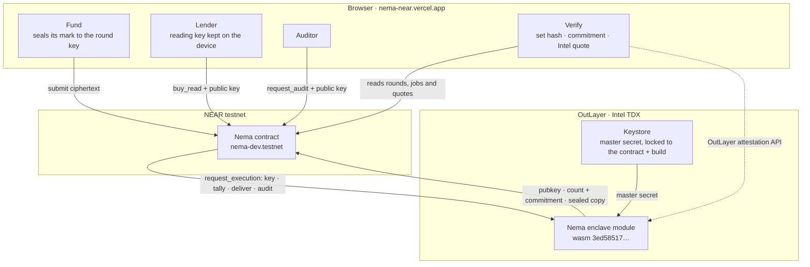
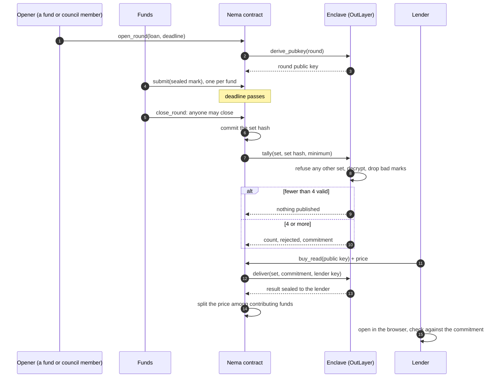
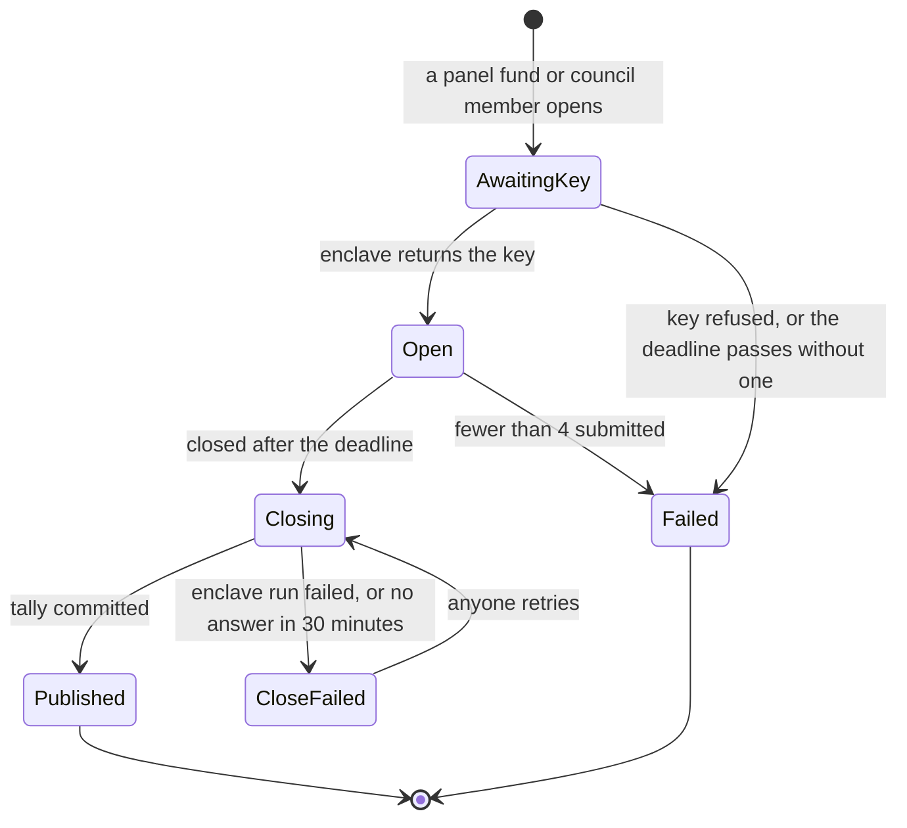

<div align="center">


# Nema

**Funds agree on a price for a private loan without showing each other their numbers.**

Sealed marks in. One consensus out. Nobody sees a single price.

[](https://github.com/Dami904/nema/actions/workflows/ci.yml)
[](#tested-not-claimed)
[](LICENSE)
[](https://nema-near.vercel.app)
[](https://testnet.nearblocks.io/address/nema-dev.testnet)
[](https://test.fastfs.io/nema-dev.testnet/outlayer.testnet/3ed58517795dc12a8f749b4ce92c747a47cbdb7ded3d383465d042060fe750d6.wasm)

**[Live app](https://nema-near.vercel.app)** · **[Docs](https://nema-near.vercel.app/docs)** · **[Judge it in 90 seconds](#judge-it-in-90-seconds)** · **[Proven on NEAR testnet](#proven-on-near-testnet)** · **[How a round works](#how-a-round-works)**

Built for the NEAR Hackathon · Privacy & Private AI track.

</div>

<!--
  DEMO VIDEO GOES HERE (under the header, before "The problem").
  On GitHub: edit README.md in the browser, drag the .mp4 into this spot, and GitHub
  inserts a https://github.com/user-attachments/assets/... link that plays inline.
-->

---

## The problem

Private loans rarely trade, so every fund prices its own holdings. Two funds can
carry the same loan at different marks, and a lender taking that loan as
collateral has to trust whichever number it is given.

Funds would compare notes if it did not mean showing their book to competitors.
A shared spreadsheet leaks every price. An administrator who collects them is one
more party to trust. And a published average over three funds is not private at
all: anyone who knows two of the marks can work out the third.

## What Nema does

Each fund seals its mark in the browser to a key only the enclave can open. When
the round closes, a hash-pinned module in an Intel TDX enclave decrypts the marks
and computes the count, mean and spread:

```text
on chain:     who took part · how many counted · who was rejected and why · a commitment
sealed:       the mean and spread, opened only by a key its reader holds
never seen:   any single fund's mark
```

- **Nobody sees a single price.** Marks are sealed to the round's key before they
  leave the browser; only the enclave can open them, and it never returns one.
- **The consensus isn't public either.** The chain holds a commitment to it. A
  lender pays to read it and the enclave seals it to that lender's key alone.
- **Funds are paid for their marks.** The read price is split equally among the
  funds whose marks counted, and they read the result for free.
- **No small rounds.** Nothing publishes below 4 valid marks, so no average can
  give away one fund's price.
- **One bad fund can't veto a round.** Out-of-range, undecryptable and copied
  marks are dropped and named.
- **Auditors see what was really sent.** A fund can name an auditor, who has the
  enclave open that fund's own marks exactly as submitted, not a copy the fund
  could edit, and tests them against the consensus.
- **Every enclave run is checkable.** The app verifies OutLayer's Intel TDX quote
  for each run in the browser, down to Nema's build hash.

**Funds seal. The enclave counts. NEAR keeps the receipts.**

---

## Judge it in 90 seconds

**Live: [nema-near.vercel.app](https://nema-near.vercel.app)**. No wallet needed
for a look around:

1. Click **Sample** at the top right. The persona menu next to it now picks who
   you are.
2. As **Fund · fund1**, open **Vault**: earnings, free reads, and a track record
   of each mark against the consensus.
3. Open **Rounds** → Calder Logistics (round 02) → **Verify**. The set hash and
   commitment are recomputed in your browser, and each enclave run is checked
   against its Intel quote.
4. Switch to **Lender**: the opened consensus, a borrowing-base tool and a CSV
   export. **Portfolio** flags Kestrel Software, whose price fell.
5. Switch to **Auditor** → **Audit**: fund1's marks as the enclave opened them.
6. Click **Live** to read the real contract on NEAR testnet, where round 02 ran in
   full.

|         |                                                                                          |
| ------- | ---------------------------------------------------------------------------------------- |
| **251** | automated tests passing: 210 contract, 32 enclave, 9 browser crypto assertions           |
| **62**  | safety guards, each removed in turn to confirm a test fails without it: 19 in v1, 43 added by the v2 council ([CLAIMS.md](docs/CLAIMS.md)) |
| **20**  | checks in the live smoke test: 20 of 20 on v1 round 6; 19 of 20 on v2 round 1, where the 20th still expected v1's split (fixed, see below) |
| **5**   | checks on every enclave run, from Intel's root certificate to Nema's build hash          |
| **4**   | valid marks at minimum before anything is published                                      |

Check the live system yourself, with nothing to install but Node:

```bash
# The round on chain: who took part, the count and the commitment, but no mean or spread
curl -s https://rpc.testnet.fastnear.com -H 'content-type: application/json' -d '{"jsonrpc":"2.0","id":1,"method":"query","params":{"request_type":"call_function","finality":"final","account_id":"nema-dev.testnet","method_name":"get_round","args_base64":"eyJyb3VuZF9pZCI6IjIifQ=="}}' \
  | node -e 'let s="";process.stdin.on("data",d=>s+=d).on("end",()=>console.log(Buffer.from(JSON.parse(s).result.result).toString()))'

# The Intel TDX quote behind round 2's tally, checked end to end
git clone https://github.com/Dami904/nema && cd nema && pnpm install && cd web
pnpm --filter nema-web live:check-attest --job 16947 --network testnet --contract nema-dev.testnet
```

---

## Contents

- [Proven on NEAR testnet](#proven-on-near-testnet)
- [NEAR and OutLayer in use](#near-and-outlayer-in-use)
- [The core proof](#the-core-proof)
- [Architecture](#architecture)
- [How a round works](#how-a-round-works)
- [The lines that hold the line](#the-lines-that-hold-the-line)
- [Tested, not claimed](#tested-not-claimed)
- [Engineering decisions](#engineering-decisions)
- [What's sample vs. real](#whats-sample-vs-real)
- [Trust model](#trust-model)
- [Live product surface](#live-product-surface)
- [Deployed](#deployed)
- [Tech stack](#tech-stack)
- [Project layout](#project-layout)
- [Run it locally](#run-it-locally)
- [How it was built](#how-it-was-built)

---

## Proven on NEAR testnet

Round 2 ran in full on 2026-11-03: four funds, a lender and an auditor, every step
a transaction you can open. The enclave runs are OutLayer jobs whose Intel quotes
pass every check (`pnpm --filter nema-web live:check-attest --job <id> --network testnet --contract nema-dev.testnet`).

| What happened | Transactions | Enclave run |
| --- | --- | --- |
| **The owner opened a round** for a term loan; the enclave derived the round's public key | [open](https://testnet.nearblocks.io/txns/ARdFHNMwsxN7BBkLhEJbz26ME1pjFCfSv8cVCkQTK3AG) | job 16942 ✓ |
| **Four funds submitted sealed marks**; the chain stores only ciphertext | [fund1](https://testnet.nearblocks.io/txns/5eHpjdpvBAb1UzC4eyknPsdcqJBDiwjuDPPdJAjTwFDg) · [fund2](https://testnet.nearblocks.io/txns/sxUY6DKoF7K7ZACjP7QFDY3xopHUYVfpE5e85ATdHyb) · [fund3](https://testnet.nearblocks.io/txns/6WVJRVdvY5qtxG1ZyAtaAKs45h82DGXKwDRz8DtCq8xC) · [fund4](https://testnet.nearblocks.io/txns/9qeXnQez4ThVshDHQhf8bG9MkaqMSipr2WVMPgno5aDC) | |
| **A fund closed the round after its deadline**; the enclave counted 4 of 4 and published the count and a commitment, not the result | [close](https://testnet.nearblocks.io/txns/Hz8DW4ZSL7W6KqxFuk1K7cgf8WsDKoZcRtgCk4yx3cTX) | job 16947 ✓ |
| **fund1 claimed its free copy**; it opened to 94.43 ± 1.7458 and matched the commitment | [claim](https://testnet.nearblocks.io/txns/8mEvBQLbEwoswZiXbkdfCrBuRRLJoZZDK1YJQQps2uNp) | job 16953 ✓ |
| **fund1 tried to claim a second free copy**: refused | [refused](https://testnet.nearblocks.io/txns/2rRBZhjLgnHs1um1o5UWSnxFJuF8ecoDZJ2y3DswnnkN) | none, by design |
| **A lender paid 0.1 NEAR to read it**; the enclave sealed the result to the lender's key, and each fund was credited 0.025 NEAR | [buy](https://testnet.nearblocks.io/txns/65z7R5YxisdECzia8MNB8HbLqTmYLrcuvMePD4sEPXB4) | job 16954 ✓ |
| **fund4 named an auditor, who had the enclave open fund4's mark**, exactly as fund4 sent it | [name](https://testnet.nearblocks.io/txns/ckEgnMEotxSKDFZkxnnbuUZviQKfDDmbeQkTbQD65HY) · [audit](https://testnet.nearblocks.io/txns/DTqbegvLFZQ5ZjECCBTteio2W2jm2vfMBTEyuYf9V52c) | job 16956 ✓ |
| **Another fund tried to audit fund4**: refused | [refused](https://testnet.nearblocks.io/txns/2SpLVSaZnC1fyF7D48AWkoEtUGdot7uxYKrwR4aUWmKn) | none, by design |

The run is `pnpm --filter nema-web live:smoke` in [`web/scripts/smoke.ts`](web/scripts/smoke.ts): 20 checks, all passing on round 6 (v1). On v2 (`nema-v2.testnet`, round 1) 19 of 20 passed; the 20th, "each fund was credited an equal share", still expected v1's split of 0.025 NEAR per fund. The chain shows the v2 split exactly: each of the four funds earned 0.02375 NEAR, each of the three council seats 0.0016667 NEAR, and the two yocto that do not divide went to the first seat. The check now expects that split and also checks the council's pay (it has not been run end to end yet).

---

## NEAR and OutLayer in use

Each piece does real work. None is decorative.

| Piece | What Nema uses it for | Code |
| --- | --- | --- |
| **NEAR contract** | Members and applications, rounds and deadlines, the sealed submissions, the committed set, listings, paid and free reads, audits, fee shares and refunds | [`contract/src/lib.rs`](contract/src/lib.rs) |
| **OutLayer TEE execution** | Runs the enclave module inside Intel TDX for each round key, tally, delivery and audit, called by the contract through `request_execution` with a callback | [`aggregator/src/main.rs`](aggregator/src/main.rs) |
| **OutLayer secrets** | The master secret is generated inside OutLayer's TEE and released only to runs requested through `nema-dev.testnet` of the exact enclave build `3ed58517…` (`Predecessor` + `WasmHash` lock) | [`aggregator/src/crypto.rs`](aggregator/src/crypto.rs) |
| **OutLayer attestations** | Each run's Intel TDX quote, checked in the browser: Intel's chain, the task hash, the worker image, Nema's build hash, the requesting contract | [`web/src/lib/attest.ts`](web/src/lib/attest.ts) |
| **NEAR Wallet Selector** | Meteor, MyNearWallet and HERE sign-in; every call is signed in the user's own wallet | [`web/src/lib/wallet.tsx`](web/src/lib/wallet.tsx) |
| **FastNEAR RPC** | Every view the app reads | [`web/src/lib/near.ts`](web/src/lib/near.ts) |

---

## The core proof

### The chain knows who took part, not what they said

Round 2 as anyone can read it (`get_round`, trimmed):

```json
{
  "id": "2",
  "status": "Published",
  "submitted": ["fund1.nema-dev.testnet", "fund2.nema-dev.testnet", "fund3.nema-dev.testnet", "fund4.nema-dev.testnet"],
  "set_hash": "e0af837ee7ff4bf8eb6f2850f59ba6739a185b76234de0f7233b1caa609a82fd",
  "listing": {
    "count": 4,
    "rejected": [],
    "commitment": "5693a6679ea94e6f5e54993abc83c278c01c9e9f524f28a7feaf3428ab874f6f"
  }
}
```

- **`submitted`**: four funds took part. Their marks are on chain only as ECIES ciphertext.
- **`set_hash`**: the exact set of ciphertexts the round committed to at its deadline. The enclave refuses to tally or deliver for any other set, and the app recomputes it in the browser.
- **`count` / `rejected`**: how many marks counted and which were dropped, with reasons.
- **`commitment`**: SHA-256 over the contract, round, a salt, the count, the mean and the spread. No mean or spread appears anywhere on chain.

### Only a reader's key opens the result

The same round, as the lender's copy opened in the browser with a key that never
left the device: `count 4 · mean 94.43 · spread 1.7458`, plus the salt. Hashing
those with the contract and round id gives `5693a667…`, the commitment above, so
the lender knows it got the result the enclave committed to and not some other
number.

---

## Architecture



| Layer | Owns |
| --- | --- |
| **Contract** (NEAR) | Who is on the panel, round deadlines, the sealed submissions, the set committed at the deadline, the listing, every read and audit, fee shares, refunds. Nothing it stores reveals a mark or the result. |
| **Enclave module** (OutLayer, Intel TDX) | Round keys, decryption, the tally, sealed delivery to one reader, audits. Stateless: everything is recomputed from the master secret and the ciphertexts the contract passes in. Answers only the contract named in the request. |
| **Keystore** (OutLayer) | The master secret, generated inside the TEE and released only to runs of Nema's exact build requested through Nema's contract. |
| **Browser** | Sealing marks, holding reading keys, opening sealed copies, and checking the set hash, commitment and Intel quotes. There is no Nema server. |

| Path | Role |
| --- | --- |
| [`contract/`](contract) | The NEAR contract (near-sdk 5.30), 210 tests |
| [`aggregator/`](aggregator) | The enclave module (Rust → `wasm32-wasip2`), 32 tests |
| [`web/`](web) | The app (React, Vite): seven pages, sample data for every state, wallet sign-in |
| [`web/scripts/`](web/scripts) | `smoke.ts` (one full live round), `close-rounds.ts`, `check-attest.ts`, `check-crypto.ts` (the `pnpm test` vectors), `cli.ts` (shared NEAR CLI wrapper) |
| [`interop/`](interop) | Browser encryption (eciesjs) against the enclave, both directions; a manual tool that regenerates the shared vectors, which the three test suites then check |
| [`testdata/`](testdata) | Shared vectors the contract, enclave and browser all test against |

---

## How a round works



### Round states



A read is `Pending` until the enclave seals it, then `Delivered`, or `Refunded` if
the enclave run fails, so a failed call never keeps a lender's money.

Every call to the enclave has three outcomes, not two: it answered, it failed, or
nothing came back yet. The contract records when each call went out
(`get_pending_since`). If no answer arrives in 30 minutes, anyone can settle it
(`reconcile_round`, `reconcile_read`, `reconcile_audit`, a **Settle** button in the
app): the close can be retried, the read is refunded, the audit can be asked again.
An answer that lands afterwards is ignored. Every state change is logged as a
NEP-297 event (`EVENT_JSON:{"standard":"nema",…}`), so an indexer can follow a round
without polling. What OutLayer actually did on testnet, as opposed to what its
docs said, is in [docs/API_NOTES.md](docs/API_NOTES.md).

---

## The lines that hold the line

The enclave answers only the contract named in the request, checked against the
account OutLayer reports as the caller
([`aggregator/src/main.rs`](aggregator/src/main.rs)):

```rust
fn handle(req: Request, master: &crypto::Master, predecessor: &str) -> Value {
    if req.contract() != predecessor {
        return fail("only the round's contract may call this module");
    }
```

Without it, anyone could ask the enclave to tally a hand-picked set, such as one
real fund's ciphertext next to three of their own, and read that fund's mark off
the mean.

And it tallies only the set the contract committed to at the deadline:

```rust
let set_hash = crypto::set_hash(&pairs);
if set_hash != expected_set_hash {
    return Err(fail("the submissions do not match the committed set"));
}
```

- **The secret is locked twice.** OutLayer releases the master secret only to Nema's exact build (`WasmHash`) requested through Nema's contract (`Predecessor`). A rebuild, or the same build called by anyone else, gets nothing.
- **A copied ciphertext is rejected.** Each fund encrypts its own account next to its mark, so replaying another fund's ciphertext gets it dropped and named.
- **Integer arithmetic only**: marks in hundredths, mean to 0.01, spread to 0.0001, with an exact integer square root. The browser checks every opened copy against the commitment.
- **The callbacks never panic.** A failed enclave call, or an answer that isn't even JSON, is recorded on the round or the read and can be retried or refunded; one that never answers is settled after 30 minutes. Nothing strands state.
- **No payment is lost.** Bonds, refunds and withdrawals that bounce (say the account was deleted) are kept as the account's earnings, and an enclave fee OutLayer refuses goes back to whoever paid it.
- **A retry never pays twice.** A second read for the same round and key is refused while the first is delivered or on its way.
- **Permissions are rechecked when the answer lands.** An audit that returns after the fund changed its auditor is not delivered, and a fund removed from the panel before the close is not counted.

---

## Tested, not claimed

**251 automated tests pass**: 210 contract (`cargo test` in `contract/`), 32 enclave
(`cargo test` in `aggregator/`) and 9 browser crypto checks (`pnpm test`). CI runs
them on every push, with lint, typecheck, the web build, `clippy -D warnings`, a
rebuild of both wasm files against their pinned hashes, and a scan for committed
secrets. On top, the live smoke test runs 20 checks on testnet and the attestation
checker runs 7 on real OutLayer jobs, including tampered copies that must fail.

Each of the 19 v1 guards that protect marks or money (the 43 the v2 council adds are listed in [CLAIMS.md](docs/CLAIMS.md)) was deleted in turn to confirm
some test fails without it: the committed-set check (contract and enclave), the
caller check, copied ciphertexts, one free copy per round, auditor-only audits,
the auditor recheck on delivery, dropping removed funds, the duplicate-read
refusal, lowercase-only keys, the 30-minute wait before settling, the refund of
a failed read, paying bonds and refunds, keeping a bounced payment as earnings,
the cap on the enclave fee, returning the fee when OutLayer refuses the call,
treating a non-JSON answer as a failure, making each mark pay for its own storage,
and ignoring a tally that answers an earlier close.

| Proof | Test |
| --- | --- |
| The enclave refuses a set other than the committed one | `tally_refuses_a_set_other_than_the_committed_one` ([`aggregator/src/tests.rs`](aggregator/src/tests.rs)) |
| Nothing publishes below the minimum | `tally_below_the_minimum_publishes_nothing` |
| The tally reveals count and commitment, never the result | `tally_publishes_count_and_commitment_but_not_the_result` |
| A delivery must match the published commitment | `deliver_refuses_a_commitment_that_does_not_match` |
| A failed enclave call is recorded, not panicked | `a_failed_enclave_call_is_recorded_not_panicked` ([`contract/src/tests.rs`](contract/src/tests.rs)) |
| A round that never got its key can be ended | `a_round_that_never_got_its_key_can_be_ended_after_its_deadline` |
| A read that never answers is refunded and pays nobody | `a_read_that_never_answers_is_refunded_and_pays_nobody` |
| Retrying a read does not pay twice | `retrying_a_read_with_the_same_key_does_not_pay_twice` |
| Every read price splits exactly, nothing lost or made | `every_read_price_splits_exactly_with_nothing_lost_or_made` |
| The contract reads OutLayer's real response | `outcome_maps_enclave_responses`, using the exact bytes OutLayer returned on testnet |
| Browser, contract and enclave agree byte for byte | the set hash, commitment and sealing vectors in [`testdata/`](testdata), checked by all three |
| Every enclave run is the published build, asked for by the contract | `pnpm --filter nema-web live:check-attest` on jobs 16942, 16947, 16954 and 16956: all checks pass |
| The whole flow works on the live network | `pnpm --filter nema-web live:smoke`: 19 of 20 on v2 round 1 (the 20th is explained above); 20 of 20 on v1 round 6, the current contract with the enclave loaded from FastFS (17 of 17 on round 2 with the earlier script) |

---

## Engineering decisions

- **Sealed in the browser, opened only in the enclave.** Marks are ECIES ciphertext from the moment they leave the fund's device; no server ever holds them.
- **The set is committed before the enclave sees it,** so the enclave can't be asked to tally a different set, and a lender can check the set it paid for.
- **A commitment instead of a public result.** The consensus is what lenders pay for, so the chain proves it exists and is fixed without giving it away.
- **Stateless enclave.** Round keys and salts are derived from the master secret, so any approved worker gives the same answer and nothing needs migrating.
- **A minimum of 4.** Below that, a mean and spread can reveal individual prices.
- **Reading keys stay on the device.** The enclave seals each copy to a public key the reader generated in the browser; the app offers a backup file.
- **Pay the people who price.** The read price goes to the funds whose marks counted, so contributing is worth something.
- **Verify in the browser, not on trust.** The app checks each run's Intel quote itself instead of showing a badge.

---

## What's sample vs. real

- **Sample mode is sample data.** The **Sample** switch fills every screen with made-up funds, rounds and reads (Calder Logistics, Kestrel Software and others), so each state can be seen without a wallet. Buying a read and submitting a mark play out on that data in the open tab, and a reload starts over. Nothing in it touches the chain.
- **Live mode is real.** It reads `nema-dev.testnet`, and every action is a signed NEAR testnet transaction.
- **The live rounds so far are test rounds** ("Smoke Test Co"), run by the smoke script with four funds and a lender the author controls. Round 2 is the full run above; rounds 3 and 4 ran on the previous build (`05e0b58e…`, same logic) on 2026-11-04, round 4 with the enclave loaded from FastFS, round 5 with a fund removed before close (its mark dropped, the round failed with 3 of 4, the deposit returned); round 1 ended without a key while a contract bug was being fixed. Round 6 ran on the current, SourceScan-verified build (`248f6ca6…`) on 2026-11-12, all 20 smoke checks passing. **v2, round 1 (2026-11-13):** run on `nema-v2.testnet` after the council registered its test loan by a 2-of-3 vote. It needed three attempts to close: OutLayer's worker started each tally job about 130 seconds after the request, and NEAR stops waiting after about 121 seconds. Each time the contract recorded `CloseFailed`, kept all four marks, and refunded all but 0.001 NEAR of the fee; the third attempt published. The paths where the council removes a fund and re-admits it (`smoke --drop`), and a council takeover, have not run on chain; their tests are in [docs/CLAIMS.md](docs/CLAIMS.md).
- **Testnet only.** No real money moves.

---

## Trust model

- **Privacy rests on the enclave hardware and its operator**, not on a threshold of independent nodes. If Intel TDX or OutLayer's worker were compromised, marks could be read. The app checks every run's quote so that a run on anything else is visible.
- **A reader who opens the result can share it.** Nema controls who can open it, not what they do afterwards.
- **A reader's key lives in that browser's storage.** Anything that can read the page's storage (an extension, someone at the machine) can open that reader's copies. The app offers a backup file; losing both means losing access.
- **A fund can still lie inside the valid range.** Out-of-range marks are caught; a plausible wrong mark is not. Its track record, and its auditor, are how that shows over time.
- **The council admits funds.** A panel of four accounts one person controls would make the minimum meaningless, so who is on the panel matters, and it is public.

- **The contract account still holds a full-access key.** Whoever has it could redeploy the contract or re-lock the enclave's secret, and expose marks. The site shows the deployed code hash so a change is visible; removing the key after the final deploy closes this.

Who is trusted for what, what each key can do if stolen, and what is not defended:
[docs/THREAT_MODEL.md](docs/THREAT_MODEL.md). What is not done yet:
[docs/LIMITATIONS.md](docs/LIMITATIONS.md). More in [DESIGN.md](DESIGN.md).

---

## Live product surface

| Route | What it shows |
| --- | --- |
| [`/`](https://nema-near.vercel.app) | Landing page: the problem, how a round works, who sees what |
| [`/rounds`](https://nema-near.vercel.app/rounds) | Every round, open, published or not |
| `/rounds/:id` | One round: submit, close, read, and **Verify** (set hash, commitment, each enclave run's Intel quote) |
| [`/vault`](https://nema-near.vercel.app/vault) | A fund's earnings, free reads, track record, reading key and auditor |
| [`/portfolio`](https://nema-near.vercel.app/portfolio) | A lender's borrowing base across every loan it opened, with CSV and PDF export |
| [`/audit`](https://nema-near.vercel.app/audit) | An auditor's desk: each client's marks as the enclave opened them |
| [`/panel`](https://nema-near.vercel.app/panel) | The panel of funds, applications, and the council's tools |
| [`/docs`](https://nema-near.vercel.app/docs) | How it works, the contract methods, the enclave, and quick starts per role |

---

## Deployed

NEAR testnet:

| What | Where |
| --- | --- |
| Nema contract (v2, council) | [`nema-v2.testnet`](https://testnet.nearblocks.io/address/nema-v2.testnet) · wasm sha256 `be2565537241d8de03976a54d1cd254cf448edf1baee109f39e3e25d62becd5d`, built reproducibly from [`cf10491`](https://github.com/Dami904/nema/tree/cf104915616fc6a5ae78c0697f7f6488364de5f9) in `sourcescan/cargo-near:0.21.1-rust-1.96.0` (`cd contract && cargo near build reproducible-wasm`; the contract reports this in `contract_source_metadata`, NEP-330). Built twice, the same hash both times; deployed code hash `DoFY4ofo…eMzz`. SourceScan verification of this build is pending |
| Nema contract (v1, owner) | [`nema-dev.testnet`](https://testnet.nearblocks.io/address/nema-dev.testnet) · wasm sha256 `248f6ca67c7a058c449cb9349546a63d18b7a2ad31879bb46d09738902f0d24a`, built reproducibly from [`8475de8`](https://github.com/Dami904/nema/tree/8475de86513911a571a29d9038a8a36bdc40d00b), **[verified on SourceScan](https://testnet.nearblocks.io/address/nema-dev.testnet?tab=contract)** (code hash `3TiXJMQA…ANVf`). The rounds listed above ran on it |
| Enclave project | OutLayer `nema-dev.testnet/nema-aggregator` |
| Enclave build | on [FastFS](https://test.fastfs.io/nema-dev.testnet/outlayer.testnet/3ed58517795dc12a8f749b4ce92c747a47cbdb7ded3d383465d042060fe750d6.wasm) (live) and the [`enclave-v2`](https://github.com/Dami904/nema/releases/tag/enclave-v2) release (standby, same bytes; `pnpm --filter nema-web live:enclave-source` checks both and switches) · wasm sha256 `3ed58517795dc12a8f749b4ce92c747a47cbdb7ded3d383465d042060fe750d6` (reproduces with Rust 1.96 on Windows with `CARGO_HOME=C:\Users\USER\.cargo`, since the wasm embeds that path; CI checks it) |
| Secret lock | `And[Predecessor{Whitelist[nema-dev.testnet]}, WasmHash(3ed58517…)]` |
| Web app | [nema-near.vercel.app](https://nema-near.vercel.app) (Vercel, static) |

---

## Tech stack

- **Chain:** NEAR testnet · near-sdk 5.30.1 · Rust
- **Enclave:** OutLayer · Intel TDX · Rust → `wasm32-wasip2` · `ecies` 0.2 (pure Rust) · `hkdf` · `sha2`
- **Web:** React 19.3 · Vite 8.3 · React Router 7.18 · TypeScript 5.9 · `eciesjs` 0.5 · NEAR Wallet Selector 10.1 (Meteor, MyNearWallet, HERE)
- **Hosting:** Vercel (static site); the contract and enclave run on NEAR and OutLayer, so there is no server

---

## Project layout

```text
nema/
├─ contract/      NEAR contract: panel, rounds, reads, audits, fees (near-sdk)
├─ aggregator/    enclave module: keys, decrypt, tally, deliver, audit (wasm32-wasip2)
├─ web/
│  ├─ src/        the app: pages, wallet, sealing, attestation checks, sample data
│  └─ scripts/    smoke, close-rounds, check-attest, check-crypto, cli
├─ interop/       browser ↔ enclave encryption check (manual; regenerates vectors)
├─ testdata/      vectors shared by the contract, enclave and browser
├─ docs/          threat model, limitations, OutLayer API notes, demo run-of-show
├─ .github/       CI: web checks, contract, enclave, wasm hashes, secret scan
├─ DESIGN.md      the design in full
└─ Cargo.toml     workspace root, so OutLayer builds the enclave from here
```

---

## Run it locally

Requires rustup (`rust-toolchain.toml` pins Rust 1.96, which the pinned hashes need), Node 24 and pnpm 11
(`corepack enable` picks up the pinned version). Nothing below needs a key or a
wallet; the only network use is downloading dependencies and the build image.

```bash
git clone https://github.com/Dami904/nema && cd nema
pnpm install

# Web app: lint, typecheck, build and the browser crypto checks, as CI runs them
pnpm check
pnpm --filter nema-web dev   # http://localhost:5179, add ?demo=1 for sample data

# Enclave: tests, then the same build OutLayer runs
cargo test -p nema-aggregator
rustup target add wasm32-wasip2
cargo build -p nema-aggregator --release --target wasm32-wasip2   # target/wasm32-wasip2/release/nema-aggregator.wasm

# Contract: tests (Linux, macOS or WSL; on Windows near-sdk's crypto needs NASM),
# then the deployed bytes. These need Docker running and cargo-near 0.21.1:
# its release binary, or `cargo install cargo-near --version 0.21.1 --locked`
cd contract && cargo test && cargo near build reproducible-wasm && cd ..   # target/near/nema_contract.wasm
```

No environment variables are needed for testnet. To point at another contract or
network, set the `VITE_*` values from `web/.env.example`; they end up in the
browser bundle, so put nothing secret there. Lint fails on any environment read
outside `web/src/lib/config.ts`, on any non-`VITE_*` key inside it, and on
`process.env` anywhere in the app. The live site deploys itself on every push to
`main`: Vercel builds from `web/`. To host your own copy, import the repo into Vercel
with the root directory set to `web`.

Scripts that sign or spend are named `live:*` and never run in CI. One of them is
a keeper: `pnpm --filter nema-web live:close-rounds --signer <account>` closes every round past its
deadline and settles any round, read or audit the enclave has left unanswered for
30 minutes (`--dry-run` lists what it would do without signing).

Run one real round on testnet and check it (signs with NEAR CLI from the OS
keychain; about 0.06 NEAR in enclave fees, mostly returned by OutLayer, about 0.08 NEAR in storage and one read price):

```bash
pnpm --filter nema-web live:smoke --opener nema-dev.testnet --lender lender.nema-dev.testnet --minutes 4
```

---

## How it was built

All code in this repo was written during the hackathon, starting 2026-11-02.

AI-assisted: the code, tests and docs were written with Claude Code (Anthropic)
pair-programming under the author's direction, across the contract, the enclave
module, the web app and the scripts. The author chose the design, reviewed the
changes and ran the deployments.

Third-party code, used as libraries and not copied in:

- Contract: `near-sdk`, `serde_json`, `hex`
- Enclave: `ecies` (pure Rust), `hkdf`, `sha2`, `serde`, `serde_json`, `hex`
- Web: React, React Router, Vite, `eciesjs`, NEAR Wallet Selector, `buffer`
- Services: OutLayer (TEE execution, secrets and attestations), FastNEAR RPC, NearBlocks explorer links
- Intel's SGX root CA public key is pinned in `web/src/lib/attest.ts` to check enclave quotes

`testdata/interop/rust.json` holds a throwaway key made for the test vectors; it
guards nothing.

Credits: the encrypt-submit, decrypt-in-enclave, aggregate pattern follows
OutLayer's [private-dao-example](https://app.outlayer.ai/docs/examples). Visual
direction drew on templates in the [Kombai gallery](https://kombai.com/gallery);
no template code is used.

## License

[MIT](LICENSE)

---

<div align="center">

**Lenders get a price they can trust. Funds never show their hand.**

</div>
